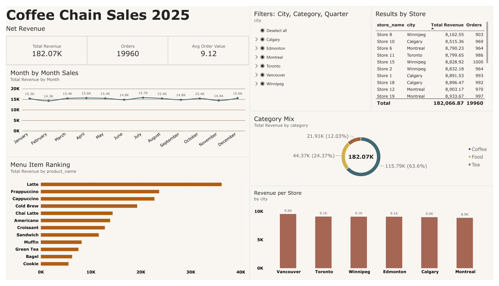

# Coffee Chain Sales Analysis (Python + SQL + Power BI)

End-to-end retail analytics project: generating and cleaning data with Python, answering business questions with SQL, and presenting results in an interactive Power BI dashboard.

Data is synthetic.



## Business questions
1. How much revenue do we make, and how does it trend by month?
2. Which products and categories drive revenue?
3. Which cities and stores perform best?
4. Do discounts increase units sold per order?

## Key findings
- Total revenue of **$182K** across **19,960 orders** (average order value **$9.12**).
- **Coffee generates ~66%** of revenue, followed by Food (~24%) and Tea (~12%). **Latte** is the top item.
- Discounts did not noticeably increase units per order, so they reduce revenue without driving volume.

## Tools and skills demonstrated
| Tool | What I used it for |
|---|---|
| Python (pandas, NumPy, matplotlib) | Data generation, cleaning (nulls, duplicates), merging, EDA |
| SQL (SQLite) | Joins, aggregation, CTEs, window functions (`LAG`, `RANK`), views |
| Power BI | Power Query, DAX measures, interactive visuals and slicers |

## Project workflow
1. `generate_data.py` creates stores, products and sales tables, with intentional missing values and duplicates.
2. `clean_load.py` cleans the data, calculates revenue and loads it into a SQLite database.
3. `sql/analysis.sql` answers the business questions and builds a `v_sales_enriched` view.
4. The view is exported to CSV and loaded into Power BI (`coffee_dashboard.pbix`).

## Data cleaning
- Removed 60 duplicate rows.
- Dropped 40 rows with missing quantity (under 0.2% of the data, so removal does not bias results).

## Example SQL
```sql
-- Month-over-month revenue growth
WITH monthly AS (
  SELECT strftime('%Y-%m', s.order_date) AS month,
         SUM(s.quantity * p.price * (1 - s.discount)) AS revenue
  FROM sales s JOIN products p ON s.product_id = p.product_id
  GROUP BY month
)
SELECT month, ROUND(revenue, 2) AS revenue,
       ROUND((revenue - LAG(revenue) OVER (ORDER BY month)) * 100.0
             / LAG(revenue) OVER (ORDER BY month), 1) AS mom_growth_pct
FROM monthly;
```

## How to run
```bash
pip install -r requirements.txt
python generate_data.py
python clean_load.py
```
Then run the queries in `sql/analysis.sql` (DB Browser for SQLite) and open `coffee_dashboard.pbix` in Power BI Desktop.

## Limitations and next steps
- Synthetic data means patterns are random; real data would show seasonality and promotion effects.
- The model is a single flat table for simplicity. Next I would build a star schema with a Calendar table.
- Add cost data to analyze profit margin, not just revenue.